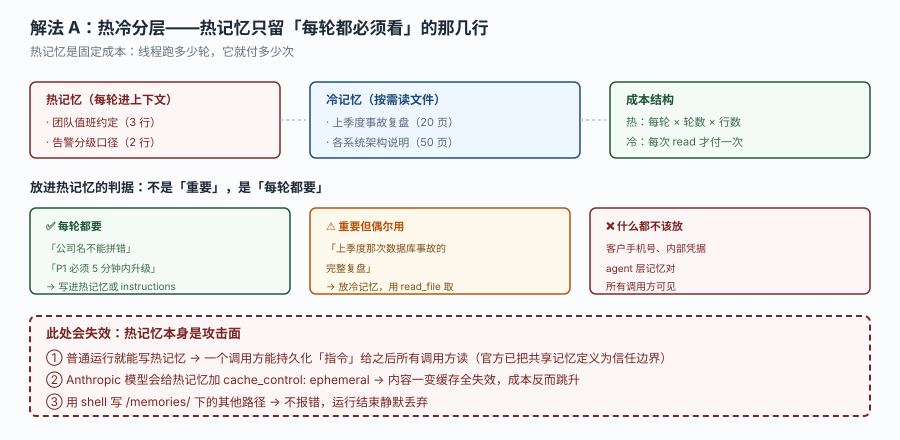
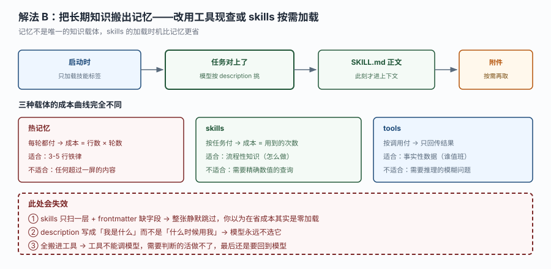
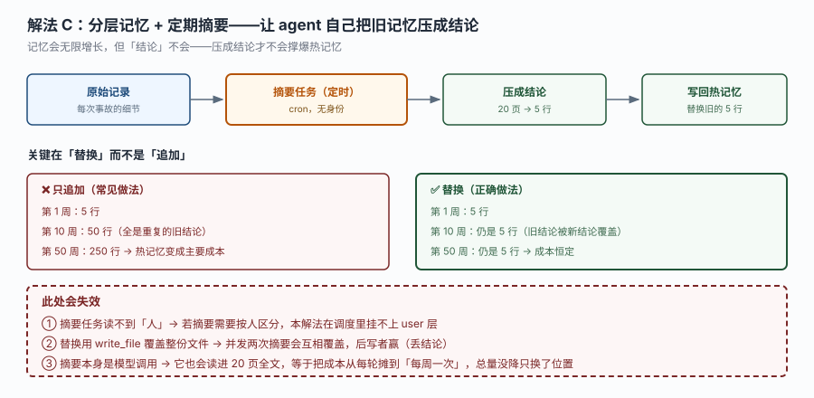

# 场景 5：记忆越长越贵怎么收敛（规模压力题）

**场景描述**：值班助手跑了半年，agent 层记忆从 5 行长到了 240 行 —— 每次事故都往里追加一条"这次怎么处理的"。现在出现三个症状：

- 单次响应从 4 秒涨到 11 秒，且与问题复杂度无关（简单问题也慢）
- 月成本翻了 4 倍，而调用量只涨了 1.3 倍
- 模型开始"记混"：把上个月的事故当成这周的，回答里出现不存在的告警

**关键认知**：agent 层记忆是**每轮固定成本**，不是"存着不花钱"。240 行 × 每轮 × 每天次数 —— 它是一条持续燃烧的账单。

**已有约束**：
- agent 层记忆对所有调用方共享（官方已把它定义为信任边界）
- 热记忆注入每一轮，且普通运行就能写它
- 用 Anthropic 模型时，热记忆会被加 `cache_control: ephemeral`
- skills 只扫一层，frontmatter 缺字段整张静默跳过

**🔒 先自己想 30 秒**：240 行里，真正"每一轮都必须看"的占几行？剩下的那些，什么时候才需要它们？你打算"删掉"还是"搬走"？两者对"以后还能查到"这件事影响完全不同。

<details><summary>💡 提示（分层 / 分维度想）</summary>

**维度一：区分"每轮都要"与"偶尔要用"**
判据不是"重要不重要"，而是"这一段在多少比例的运行里会用到"。用不到的每一行都是纯浪费。

**维度二：换载体而不是删内容**
记忆、skills、tools 是三种成本曲线完全不同的载体。同一份知识放错载体，成本差一个数量级。

**维度三：增长本身要设计**
如果写入是"只追加"，那无论初始设计多好，最终都会膨胀。需要设计"替换"而不是"追加"。

</details>

<details><summary>📖 展开解法</summary>

### 解法一览

| 解法 | 效果（成本改善 / 检索精度 / 实现复杂度 / 风险） | 代价 | 适用边界 |
|------|------------------------------------------|------|---------|
| A. 热冷分层 | **最高**（直降 80%+） / 中 / 低 | 需要判断"哪些进热"，判错会丢关键约束 | 记忆里有大量"参考资料"型内容 |
| B. 换载体（skills / tools） | 高 / **最高** / 中 | 要改造调用方式，skills 有静默失效坑 | 知识是"流程"或"事实"而非"约定" |
| C. 分层 + 定期摘要 | 中高 / 中 / 高 | 摘要本身要花模型调用；替换需防并发覆盖 | 记忆内容会持续新增且需要保留结论 |

### 各解法详解

#### 解法 A：热冷分层

思路：把记忆切成两层 —— 热层只留"每轮都必须看"的 3–5 行铁律，其余全部搬到冷层，用 `read_file` 按需读。



读图：左边热记忆（每轮进上下文，3 行约定 + 2 行口径），中间冷记忆（按需 read，20 页复盘 + 50 页架构说明），右边是成本结构对比（热：每轮 × 轮数 × 行数；冷：每次 read 才付一次）。下排三个判据框：每轮都要 → 热；重要但偶尔 → 冷；含隐私凭据 → 都不放。**红框三处**：热记忆是攻击面、Anthropic 缓存会因内容变化全失效、shell 写记忆静默丢弃。

```python
# 热层：只留 5 行，写在 agent 层记忆的固定文件里
HOT_MEMORY = """
- 公司名是「XX 科技」，不要简写
- P1 必须在 5 分钟内升级，P2 在 30 分钟内
- 团队标识只有 platform / infra / data 三个
"""

# 冷层：详细复盘按主题分文件，不在 tools/ 里写"读记忆"的函数。
# 记忆只能由模型通过内置的 read_file / edit_file / write_file 访问，
# 你自己的工具拿不到通往 Context Hub 的路（runtime.backend 只覆盖沙箱）。
# 所以这里只做一个"写复盘"的入口：内容由人/上游准备好，落到冷层路径。
@tool
def save_incident_playbook(topic: str, content: str) -> str:
    """保存某类历史事故的复盘到冷层。topic 如 database / network / deploy。"""
    path = f"/memories/agent/playbooks/{topic}.md"
    # 实际写入由模型侧 write_file 完成；本工具只做入库前校验
    if len(content) < 200:
        return f"复盘过短（{len(content)} 字符），冷层至少需要 200 字符。"
    return f"请用 write_file 将以下内容写入 {path}：\n{content}"
```

> **该解法特有的坑**：热记忆本身是攻击面。官方已把共享记忆定义为信任边界 —— **普通运行就能写热记忆**，所以一个调用方能持久化"指令"给之后所有调用方读。铁律里不能放任何"模型应该照做"的可写内容。
> 第二个坑：用 Anthropic 模型时热记忆带 `cache_control: ephemeral`，内容一变更缓存全失效。频繁改写热记忆会让成本**反而跳升**。

#### 解法 B：换载体（skills / tools）

思路：把"流程性知识"搬进 skills（模型按任务挑，不选中就不进上下文），把"事实性数据"搬进 tools（按调用返回，只回传结果）。



读图：上排是 skills 加载链路（启动只加载标签 → 任务对上 → 正文此时才进上下文 → 附件按需再取）。下排三栏是三种载体的成本曲线：热记忆（每轮付）、skills（按任务付）、tools（按调用付）。**红框三处**：skills 只扫一层 + frontmatter 缺字段静默跳过、description 写错模型永不选、全搬工具则判断类活做不了。

```markdown
---
name: incident-triage
description: 当收到告警需要判断严重程度与升级路径时使用。包含定级口径、三步初判与常见模式表。
---

# 事故初判手册

## 第一步：确认影响面
...
```

```python
@tool
def get_oncall(team: str) -> str:
    """查询某团队当前值班人。事实性数据，走工具而不是记忆。"""
    return roster_client.get(team)
```

> **该解法特有的坑**：skills 的加载有前提 —— 只扫一层目录，且 frontmatter 必须有 `name` + `description`，缺任一项**整张静默跳过**（build exit=0，没有任何提示）。搬完必须验证"真的被发现了"，否则你以为在省成本，实际是零加载。
> `description` 必须写"什么时候用我"而不是"我是什么"。模型是拿这句话判断要不要加载的 —— 写成"这是一个事故处理手册"等于没写。

#### 解法 C：分层 + 定期摘要

思路：允许记忆持续写入，但加一个定时任务，把冷层的多条原始记录压成"结论"，**替换**旧的结论段，而不是追加。



读图：主链是"原始记录 → 定时摘要任务 → 压成结论（20 页 → 5 行）→ 写回热记忆（替换旧的 5 行）"。下半部对比两种做法：只追加时第 50 周变成 250 行、成本失控；替换时永远 5 行、成本恒定。**红框三处**：摘要任务读不到"人"、并发覆盖丢结论、摘要本身也读全文（成本只是换位置）。

```python
schedule = define_schedule(
    cron="0 3 * * 0",                    # 每周日凌晨三点
    timezone="Asia/Shanghai",
    prompt=(
        "读取 /memories/agent/playbooks/ 下本周新增的复盘记录，"
        "提炼成不超过 5 条结论，写入 /memories/agent/conclusions.md。"
        "必须替换整个文件，不要追加。如果新结论与旧结论冲突，以新的为准并说明原因。"
    ),
)
```

> **该解法特有的坑**：摘要任务没有"人"（principal 恒为服务身份），所以它只能操作 agent 层记忆，挂不上 user 层。
> 第二个坑：`write_file` 覆盖整份文件时，两次并发摘要会互相覆盖（后写者赢，前者的结论丢失）。要么让摘要任务串行（cron 天然接近串行），要么用能按块替换的方式。
> 第三个坑：摘要本身也要读进全文 —— 成本只是从"每轮付"变成"每周付一次"，总量仍然存在。这个解法压的是**频率**，不是**总量**。

### 替代路线（非本课程技术栈）

| 替代方案 | 思路 | 与本课程解法的差异 |
|---------|------|------------------|
| 向量检索 + RAG（外部向量库） | 记忆不做"全量注入"，改成"按问题检索 top-k 片段" | 精度最高（只取相关片段），但引入新组件、增加一次检索延迟，且检索失败时模型没有兜底知识 |
| 结构化知识库（数据库 + 查询工具） | 把"事故复盘"变成表结构，用 SQL 查 | 最可控（可聚合、可统计"连续三天"），但要求内容先结构化，人工成本高 |
| 分层摘要树（L0 全量 / L1 摘要 / L2 一句话） | 多级摘要，按问题复杂度取不同层 | 兼顾精度与成本，但实现复杂、需要维护多份摘要的一致性 |

### 推荐路径（递进，不是一次全上）

1. **先上 A（热冷分层）** —— 一次性动作，收益立竿见影。先把 240 行砍到 5 行，剩下的搬冷层。
2. **再上 B（换载体）** —— 把冷层里"流程型"内容搬进 skills、"事实型"搬进 tools。这一步决定了长期成本曲线。
3. **最后上 C（定期摘要）** —— 只有确认记忆会持续增长时才需要。它解决的是"随时间膨胀"，不是"当前太大"。

**顺序的理由**：A 解决"现在太大"，B 解决"放错了地方"，C 解决"以后还会长大"。跳过 A 直接做 C 是最常见的错误 —— 摘要一个本来就不该进热层的东西，等于把浪费制度化。

### 知识点挂钩

- 解法 A → 阶段 2 课 6《记忆、沙箱与身份》知识点 2（热冷记忆与成本结构）+ 知识点 1（双层记忆）
- 解法 B → 阶段 2 课 4《指令、技能与工具》知识点 2（技能发现与 frontmatter 门槛）+ 知识点 3（工具注册）
- 解法 C → 阶段 2 课 6 知识点 2 + 阶段 3 课 8《通道与调度》知识点 2（调度声明）
- 替代路线"向量检索 RAG" → 与本课程知识点 2「热记忆每轮注入」对照（差异见上表）

### 什么情况下此方案不适用

**记忆里全是"必须每轮看"的铁律**：那说明你的 agent 承担了过多规则。该做的是**拆部署**（见 [场景 4](场景-04-流量翻十倍.md)），而不是压缩记忆。

**多租户场景**：agent 层记忆对所有调用方共享。任何"按客户区分"的记忆都不能放这里 —— 无论是热层还是冷层。这个限制不是靠分层能解决的。

**需要"连续 N 天"这类时间序列判断**：记忆是文档不是数据库。这类判断应该让工具去查外部历史表，而不是试图从记忆文本里推。

### 做错会踩的坑

→ 关联 [故障模式 5：用户私有记忆永远是空的](../08-实战经验.md#m5)
→ 解法 B 搬 skills 时目录嵌套或 frontmatter 缺字段，会命中 [故障模式 2：技能写得很认真，模型从来不用](../08-实战经验.md#m2)（技能未被发现，build 绿灯）
→ 解法 A 用 shell 写记忆会静默丢弃，见 [第 5 条：`/memories/user/` 永远是空的](../09-排障速查手册.md#s5) 的相邻分支

</details>
