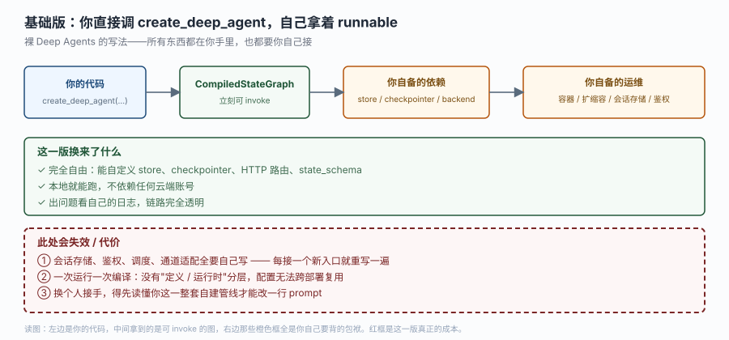
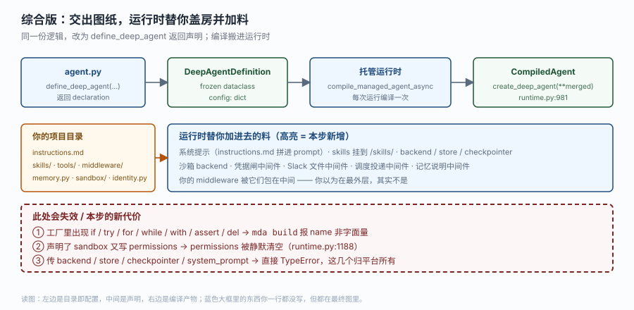

# 应用实战 · 托管的是什么

> 对应课程：[第 2 课：托管的是什么](../stages/1-定位与起跑/lessons/02-托管的是什么.md) ｜ 覆盖知识点：定义与编译分离、项目即配置、与 Deep Agents 的边界
> 定位：**会用，不上生产**——课里学完，在这里动手（结构与边界见 SKILL.md「教学叙事骨架 · 应用实战」）。
> 📖 结论已按官方文档核对（核对于 2026-10 ｜ 来源：`/langsmith/python/managed-deep-agents-overview`、`-agent-definition`、`-project-structure`）

## 场景：把一份已经跑通的 agent 搬到托管上

你有一个用 `create_deep_agent` 写的值班助手，本地跑得好好的：

```python
# before/main.py（裸 Deep Agents）
from deepagents import create_deep_agent

agent = create_deep_agent(
    model="openai:gpt-5.5",
    system_prompt="你是值班助手，帮我看告警、查排班。",
    tools=[read_oncall_roster, query_open_alerts],
)
print(agent.invoke({"messages": [{"role": "user", "content": "今天谁值班？"}]}))
```

产品经理说："能不能让 Slack 里的人也能直接问？顺便每天早八自动发晨报。"

你立刻意识到：Slack 接入、定时触发、会话保存、鉴权，这四件事一件都没写。于是你决定迁到 MDA。

**全貌一句话**：完整方案还需要 Slack app 配置、LangSmith 云端账号、模型额度（非本课内容），本课不展开；这里只关心"迁过去之后，你手里的东西变成了什么"。

## ① 基础实现（能跑但幼稚）

第一反应通常是把同一份代码"套进" MDA 的壳里——照抄 `define_deep_agent` 的参数，然后想办法把它当 agent 用。



> 看图：左边是你的代码，中间拿到的是可 `invoke` 的图，右边三个橙色框（store / checkpointer / backend、容器与会话存储、鉴权）全是你自己要背的包袱。这就是迁移前的状态。

```python
# before/agent.py —— 错法：以为 define 出来的东西能直接 invoke
from managed_deepagents import define_deep_agent
from tools.oncall import query_open_alerts, read_oncall_roster

agent = define_deep_agent(
    name="duty-assistant",
    model="openai:gpt-5.5",
    system_prompt="你是值班助手。",        # ← 这里就炸了
    tools=[read_oncall_roster, query_open_alerts],
)

agent.invoke({"messages": [{"role": "user", "content": "今天谁值班？"}]})
```

跑起来立刻得到两个错：

```
TypeError: Remove `system_prompt` from define_deep_agent(...).
Use `instructions` in a factory entrypoint or put the static prompt in instructions.md.

AttributeError: 'DeepAgentDefinition' object has no attribute 'invoke'
```

> ⚠️ **它的问题**：
> 1. `system_prompt` 是平台所有的键，`define_deep_agent` 直接拒收（`define_deep_agent.py` 的 `DEFINE_DEEP_AGENT_UNSUPPORTED_KEYS`）。
> 2. 定义出来的东西**没有 `invoke`**——它不是 runnable。`DeepAgentDefinition` 只有 `config` 一个字段和 `kind` 一个类变量。
> 3. 就算你把上面两条都绕过，也仍然没有 Slack 接入、没有调度、没有会话持久化——因为它们不是参数，是**目录里的文件**。

## ② 综合实现（被问题逼出来的下一步）

问题的根不是"参数写错了"，而是"你还在用参数思维想一个落点是文件的系统"。改成托管口径：



> 看图：比上一张多了什么——中间多了 `DeepAgentDefinition` 这一层，编译被搬进运行时；左边从"一份 main.py"变成"一个目录"；蓝色大框里那堆注入（系统提示、skills、backend/store/checkpointer、沙箱、四个中间件）你一行都没写，但都在最终图里。

```
duty-assistant/
├── agent.py             # 只交图纸
├── instructions.md      # 系统提示（静态部分）
├── skills/
│   └── escalate/SKILL.md
└── tools/
    └── oncall.py
```

```python
# agent.py —— 静态入口：直接导出 definition，连函数都不写
from managed_deepagents import define_deep_agent
from tools.oncall import read_oncall_roster, query_open_alerts

agent = define_deep_agent(
    name="duty-assistant",                      # 必填，成为 graph id 与默认部署名
    model="openai:gpt-5.5",
    tools=[read_oncall_roster, query_open_alerts],   # 知识点 3：必须显式点名
)
```

```markdown
<!-- instructions.md —— 知识点 2：提示词落在文件里，不再走参数 -->
你是值班助手。回答前先查排班，涉及升级时按 skills/escalate 的流程走。
只回答值班相关问题；问到别的领域，说明不在职责范围内。
```

```python
# tools/oncall.py —— 知识点 3：工具必须被入口 import 才存在
from langchain.tools import tool

@tool
def read_oncall_roster(day: str) -> str:
    """查某天的值班人。day 用 YYYY-MM-DD。"""
    return f"{day} 值班：张工（platform）"
```

验证你确实迁对了，跑这两条：

```bash
mda build            # 产出编译归档；此时 name 是静态字面量，能读出来
mda dev              # 本地起服务，只在本地内存里跑
```

```python
# 想亲眼确认"定义不是 agent"：这是课 2 那个探针的最小版
from agent import agent
print(type(agent).__module__ + "." + type(agent).__name__)
# managed_deepagents.define_deep_agent.DeepAgentDefinition
print(sorted(agent.config))
# ['model', 'name', 'tools']  ← 只有你写的三项，没有任何 runnable
```

> 🎯 **会用标志**：能不看文档说清三件事——① `define_deep_agent` 返回什么、为什么不能 `invoke`；② 新加一个能力时该动哪个文件，而不是该加哪个参数；③ 哪些键传进去会被直接拒绝、分别该改到哪里。

## 🧭 导航

- ⬅️ 回到课程：[第 2 课：托管的是什么](../stages/1-定位与起跑/lessons/02-托管的是什么.md)
- 📚 全部实战：[应用实战索引](INDEX.md)
- ➡️ 下一篇实战：[04 · 把内部工单 API 做成 agent 的声明式工具](04-指令技能与工具.md)
