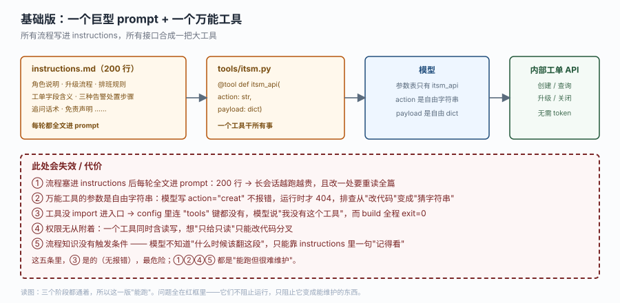
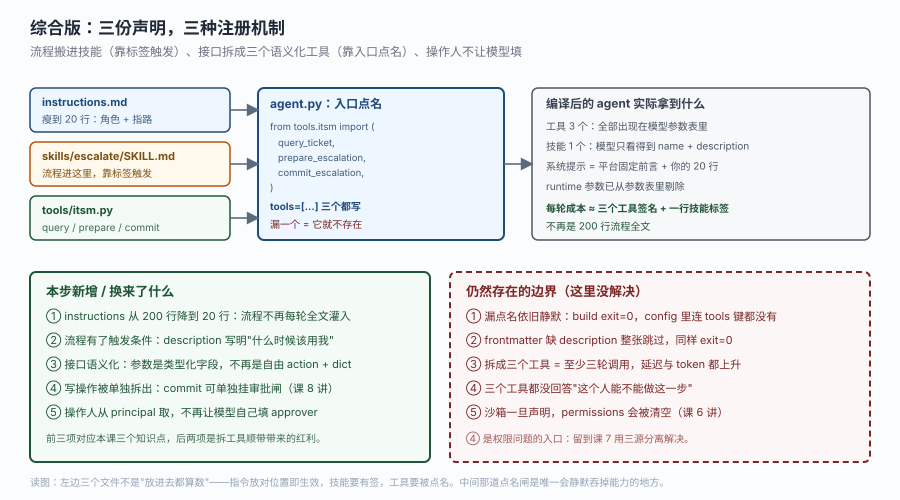

# 应用实战 · 指令、技能与工具

> 对应课程：[第 4 课：指令、技能与工具](../stages/2-能力声明/lessons/04-指令技能与工具.md) ｜ 覆盖知识点：指令即系统提示、技能目录与渐进披露、自定义工具与运行上下文
> 定位：**会用，不上生产**——课里学完，在这里动手（结构与边界见 SKILL.md「教学叙事骨架 · 应用实战」）。
> 📖 结论已按官方文档核对（核对于 2026-10 ｜ 来源：`/langsmith/python/managed-deep-agents-instructions`、`-skills`、`-tools`）＋ 本机实测（`managed_deepagents 0.9.5`）

## 场景：内部工单系统要接进来，但它有四种操作

客服 agent 上线一周后，运维提了需求："把内部工单系统接给 agent，让它能查单、能升级。"

你先去问了工单系统维护者，拿到四个接口：`GET /tickets/{id}`、`POST /tickets`、`POST /tickets/{id}/escalate`、`POST /tickets/{id}/close`。每个都有自己的必填字段和状态前置条件——比如"只有 `open` 状态的单能升级"、"升级必须填升级理由和接收组"。

第一天你写出来的东西是这样的：

- `instructions.md` 200 行。角色、升级流程、排班规则、工单字段含义、三种告警的处置步骤、追问话术、免责声明，全在里面。
- `tools/itsm.py` 一个工具 `itsm_api(action: str, payload: dict)`。所有接口都从这一个工具进去。

跑起来没报错。但它每一轮都在往模型嘴里塞 200 行，而模型手上只有一个自由度极高的字符串参数。

**全貌一句话**：这一篇只解决"三份声明各放什么、各自怎么才算生效"；审批闸、按人分权、防重复提交都不在本课，留到课 7 / 课 8。

## ① 基础实现（能跑但幼稚）



> 看图：四个框从左到右全部连通，所以这一版确实能跑。注意最左边那个框底下那行小字——`instructions.md` 里的 200 行是**每轮都全文进 prompt** 的，不是"加载一次就缓存"。再看第三个框：模型看到的参数表里只有 `itsm_api` 一个名字，`action` 是自由字符串、`payload` 是自由 dict，模型想写什么就写什么。底部红框是这一版的五条代价，其中第 ③ 条是静默的。

```python
# instructions.md 的骨架（200 行的浓缩版）
# 你是 A 公司的客服助手。下面是你必须遵守的全部规则。

# ## 一、角色与语气        （30 行）
# ## 二、升级流程           （60 行：判断依据 → 填什么字段 → 通知谁 → 话术）
# ## 三、排班规则           （25 行）
# ## 四、工单字段含义        （40 行）
# ## 五、三种告警的处置步骤   （35 行）
# ## 六、追问话术与免责声明   （10 行）
```

```python
# tools/itsm.py —— 一个工具干所有事
import httpx
from langchain.tools import tool

ITSM = "http://itsm.internal/api"

@tool
def itsm_api(action: str, payload: dict) -> str:
    """调用内部工单系统。action 是要执行的动作，payload 是参数。"""
    if action == "get":
        r = httpx.get(f"{ITSM}/tickets/{payload['id']}")
    elif action == "create":
        r = httpx.post(f"{ITSM}/tickets", json=payload)
    elif action == "escalate":
        r = httpx.post(f"{ITSM}/tickets/{payload['id']}/escalate", json=payload)
    elif action == "close":
        r = httpx.post(f"{ITSM}/tickets/{payload['id']}/close", json=payload)
    else:
        return f"未知 action：{action}"
    return r.text
```

```python
# agent.py
from managed_deepagents import define_deep_agent
from tools.itsm import itsm_api

agent = define_deep_agent(
    name="support-agent",
    model="openai:gpt-5.5",
    tools=[itsm_api],
)
```

`mda build` 绿灯，`mda dev` 能聊，一切看起来正常。

> ⚠️ **它的问题**（五条，按危害排序）：
> 1. **流程知识没有触发条件**。60 行升级流程躺在 instructions 里，模型只能靠"记得看"来决定用不用。它不知道"什么时候该翻这段"，因为这段从来没有被标成"某类任务专用"。
> 2. **参数类型全丢了**。`payload: dict` 在模型看来是"随便填个对象"，而工单系统要求 `escalate` 必须有 `reason` 和 `assignee_group`。模型会自己编字段名，`400` 要到运行时才出现。
> 3. **静默失败最危险的一条**：如果哪天有人重构 `tools/itsm.py`，把函数改个名但忘了同步 `agent.py` 的 `tools=[...]`——`mda build` 依然 exit=0，`config` 里连 `tools` 这个键都不存在，模型会说"我没有工单工具"，而你在一堆日志里找不到任何 error。
> 4. **成本随会话线性增长**。200 行约 3000 token，每轮都进。10 轮对话就是 3 万 token 的重复输入，而其中 90% 与当前这句无关。
> 5. **能力无法分权**。`itsm_api` 同时包含读和写，你想"只给只读账号"只能改代码分叉出两个函数——但那已经是重构，不是配置。

第 3 条值得单独说一句：它不是"设计不好"，它是**这套机制的真实行为**。技能和指令是自动发现的，工具不是。工具必须被入口 import 并点名。

## ② 综合实现（被问题逼出来的下一步）

问题不是"prompt 写得不够好"，而是"三样东西被塞进了同一个容器"。MDA 给的容器是三个，各自有不同的注册机制：



> 看图：左边三个框是你要写的三个文件，颜色区分它们的生效方式——蓝色（放进根目录就生效）、橙色（要有合法 frontmatter 才算技能）、绿色（必须被点名才注册）。中间窄框 `agent.py` 是唯一的"点名闸"：三条箭头全从这里过。右边把编译后的实际结果摊开，重点是最后两行——**每轮成本从 200 行流程全文降成三个工具签名加一行技能标签**。底部绿框是本步收益，红框是还没解决的边界，其中第 ④ 条（"没人回答这个人能不能做这一步"）是刻意留给课 7 的。

```
support-agent/
├── agent.py
├── instructions.md              # 瘦到 20 行：角色 + 指路
├── skills/
│   └── escalate/
│       └── SKILL.md             # 60 行升级流程搬到这里
└── tools/
    └── itsm.py                  # 三个语义化工具
```

**第一步：把 60 行流程从 instructions 挪进 skill。** 判据很简单——"只有做某类任务时才需要看的内容"就不该住在 instructions 里。

```markdown
<!-- skills/escalate/SKILL.md -->
---
name: escalate
description: 升级一条工单给二线团队。当用户要求升级、投诉处理太慢、或告警严重级别为 P1/P2 时使用。覆盖状态校验、字段补全、通知对象选择。
---

# 工单升级流程

只有 `open` 状态的工单可以升级。按顺序：

1. 用 `query_ticket` 查当前状态。不是 `open` 就直接告诉用户原因，不要强行升级。
2. 用 `prepare_escalation` 生成升级草案，它会校验目标组是否存在。
3. 把草案内容原样念给用户确认，得到明确同意后才调 `commit_escalation`。
4. 汇报时说明：升级到了哪个组、依据是哪条规则、工单号是多少。

不要跳过第 3 步。未经确认的升级在生产上等于误操作。
```

注意 `description` 干了三件事：说清做什么（升级工单）、列出触发词（升级 / 太慢 / P1P2）、点明覆盖范围（校验 + 补全 + 通知）。模型手上只有这几十个字做判断，**这就是你能"编程"技能选择的唯一位置**。

**第二步：把 `itsm_api` 拆成三个语义化工具。** 拆的判据不是"接口有几个"，而是"模型需要在哪几个决策点上被约束"。

```python
# tools/itsm.py
import httpx
from langchain.tools import tool
from managed_deepagents import ManagedToolRuntime

ITSM = "http://itsm.internal/api"

@tool(parse_docstring=True)
def query_ticket(ticket_id: str) -> str:
    """查询一条工单的当前状态与字段。

    Args:
        ticket_id: 工单号，形如 T-20261028-001。
    """
    r = httpx.get(f"{ITSM}/tickets/{ticket_id}", timeout=10)
    if r.status_code == 404:
        return f"工单 {ticket_id} 不存在。"
    return r.text

@tool(parse_docstring=True)
def prepare_escalation(ticket_id: str, target_group: str, reason: str) -> str:
    """生成升级草案但不执行。必须先给用户确认，再调 commit_escalation。

    Args:
        ticket_id: 要升级的工单号。
        target_group: 接收组，如 platform / network / billing。
        reason: 升级理由，一句话说明为什么现在必须升级。
    """
    return f"草案：把 {ticket_id} 升级到 {target_group}，理由：{reason}。等待用户确认。"

@tool(parse_docstring=True)
async def commit_escalation(
    ticket_id: str,
    target_group: str,
    reason: str,
    runtime: ManagedToolRuntime,
) -> str:
    """真正执行升级。只在用户明确同意后调用。

    Args:
        ticket_id: 要升级的工单号。
        target_group: 接收组。
        reason: 升级理由。
    """
    principal = runtime.server_info.principal if runtime.server_info else None
    if principal is None:
        return "拒绝：本次调用没有已验证身份，不能执行写操作。"

    async with httpx.AsyncClient(timeout=10) as client:
        r = await client.post(
            f"{ITSM}/tickets/{ticket_id}/escalate",
            json={
                "target_group": target_group,
                "reason": reason,
                "operator": principal.id,      # 操作人由平台给，不让模型填
            },
        )
    if r.status_code != 200:
        return f"升级失败（{r.status_code}）：{r.text}"
    return f"已升级 {ticket_id} 到 {target_group}，操作人 {principal.id}。"
```

三个工具的分工是刻意的：`query_ticket` 只读、无副作用，可以随便调；`prepare_escalation` 也不写，它存在的唯一理由是**给模型一个"先出草案"的动作**；`commit_escalation` 才写，并且它的 `operator` 字段不是参数——从 `principal` 取。模型无法声称"是张三让我升的"。

**第三步：在入口点名，三个都不能漏。**

```python
# agent.py
from managed_deepagents import define_deep_agent

from tools.itsm import commit_escalation, prepare_escalation, query_ticket

agent = define_deep_agent(
    name="support-agent",
    model="openai:gpt-5.5",
    tools=[query_ticket, prepare_escalation, commit_escalation],
)
```

**第四步：instructions 瘦身，只留角色与指路。**

```markdown
<!-- instructions.md -->
# 客服助手

你是 A 公司的客服助手，负责查询工单状态与处理升级请求。

## 你必须遵守
- 查不到就说查不到，不要编造工单状态。
- 任何写操作（升级、关闭）都必须先让用户确认草案再执行。
- 用中文回答，简短直接。

## 你手上有什么
- `query_ticket`：查工单状态。
- `prepare_escalation` / `commit_escalation`：升级工单，先 prepare 再 commit。
- 技能 `escalate`：升级的完整流程与前置校验。遇到升级请求时按它走。
```

最后那行是关键。技能能不能被选中，很大程度上取决于 instructions 里有没有指路——模型平时只看得到技能的 `description`，看不到正文。

**验证你确实拆对了：**

```bash
mda build     # 应该 exit=0，且没有 Build warnings
mda dev       # 本地起服务
```

```python
# 用探针确认"注册"这件事真的发生了
from agent import agent
print(sorted(agent.config))
# ['model', 'name', 'tools']
print([t.name for t in agent.config["tools"]])
# ['query_ticket', 'prepare_escalation', 'commit_escalation']

# 反过来：故意注释掉某一行 tools=[...]，再看
# "tools" in agent.config  ->  False
# agent.config["tools"]    ->  KeyError: 'tools'
```

那个"键不存在"与 `[]` 的差别值得记住：空列表意味着"我配了，但配成空的"（`"tools" in config` 为 `True`）；键不存在意味着"这个字段你根本没提"（`"tools" in config` 为 `False`，硬取会 `KeyError`）。模型侧看到的效果一样（零个自有工具），但排查时含义不同——所以探针里读可选键要用 `config.get("tools")`，别直接下标。

> 🎯 **会用标志**：能不看文档说清四件事——① 一段新规则该进 `instructions.md` 还是 `skills/<名字>/SKILL.md`，判据是什么；② 一个内部 API 该拆成几个工具、按什么拆；③ 工具写完还差哪一步才算真的注册上；④ 工具的 `runtime` 参数里，哪个字段能判权限、哪个只能选行为。

## 🧭 导航

- ⬅️ 回到课程：[第 4 课：指令、技能与工具](../stages/2-能力声明/lessons/04-指令技能与工具.md)
- 📚 全部实战：[应用实战索引](INDEX.md)
- ⬅️ 上一篇实战：[02 · 同一份逻辑，托管前后差在哪](02-托管的是什么.md)
- ➡️ 下一篇实战：[06 · 团队记忆与个人记忆](06-记忆沙箱与身份.md)
