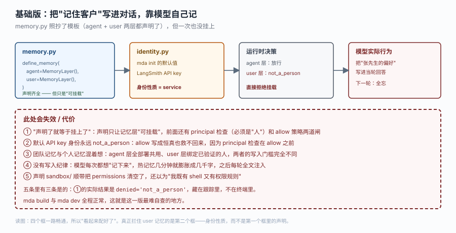
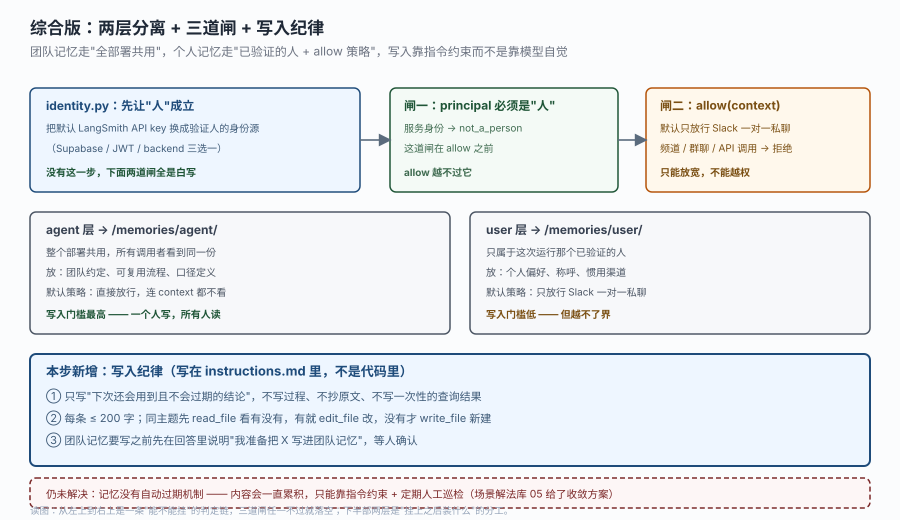

# 应用实战 · 记忆、沙箱与身份

> 对应课程：[第 6 课：记忆、沙箱与身份](../stages/2-能力声明/lessons/06-记忆沙箱与身份.md) ｜ 覆盖知识点：双记忆层与默认策略、冷热记忆与写入纪律、沙箱与身份
> 定位：**会用，不上生产**——课里学完，在这里动手（结构与边界见 SKILL.md「教学叙事骨架 · 应用实战」）。
> 📖 结论已按官方文档核对（核对于 2026-10 ｜ 来源：`/langsmith/python/managed-deep-agents-memory`、`-sandboxes`、`-identity`、`-context-hub`）＋ 本机实测（`managed_deepagents 0.9.5`，`resolve_user_memory_access` 四种返回值）

## 场景：客服 agent 上线两周，用户开始重复说同样的话

客服 agent 上线两周，投诉集中在两句话：

- "我上次就说过我是财务部的，为什么每次都要重新说。"
- "你们那个 agent 每次都问我用哪个渠道联系，我说过三遍了。"

产品经理要的是一句话："让它记住人。"而你面前有两类完全不同的"记住"：

- **团队口径**：财务部的退款要双签、P1 告警必须在 15 分钟内升级——这对所有客服都成立，不该每人重教一遍。
- **个人偏好**：张先生习惯微信联系、李女士只接受邮件、王工喜欢先看结论——这不该让张先生之外的人看到。

MDA 把这两类分别放在两层：

| 层 | 挂载点 | 属于谁 | 放什么 |
|---|---|---|---|
| agent | `/memories/agent/` | 整个部署，所有调用者共用 | 团队约定、可复用流程 |
| user | `/memories/user/` | 发起这次运行的那个已验证的人 | 个人偏好、调用者专属上下文 |

**全貌一句话**：这一篇只解决"两层记忆怎么才挂得上、挂上之后装什么"；跨团队的按来源分流配置不在本课，留到课 7。

## ① 基础实现（能跑但幼稚）

你照着官方示例把 `memory.py` 写齐了，两层都声明。本地 `mda dev` 一聊，感觉确实"记住了"——你在同一轮对话里说了名字，它在后面几轮都记得。你以为成了。



> 看图：四个框一路畅通，所以看起来配好了。但注意第二个框——`identity.py` 还是 `mda init` 的默认值（LangSmith API key），它的身份性质是 `service`。第三个框就是后果：agent 层放行，user 层直接 `not_a_person` 拒绝挂载。最后那个框解释了为什么你没发现——**它在当轮对话里确实"记得"**，因为上下文窗口就在那儿；下一轮换了新会话，全忘。

```python
# memory.py —— 声明看起来完全正确
from managed_deepagents import MemoryLayer, define_memory

memory = define_memory(
    agent=MemoryLayer(),
    user=MemoryLayer(),
)
```

```python
# identity.py —— 没动，还是 mda init 的默认值
# （默认 LangSmith API key，kind = service）
```

```markdown
<!-- instructions.md 里你补了一句，希望它自己记 -->
## 记住客户
遇到客户提供姓名、部门、偏好联系方式时，记下来，下次直接用。
```

验证一下你以为的"记住了"：

```text
第 1 轮：我叫张伟，财务部的，以后发我邮件就行。
        → agent：好的张伟，我记住了，以后邮件联系。

第 2 轮（新会话）：帮我查一下上周的报销单。
        → agent：请问您是哪位？方便留一下部门和联系方式吗？
```

它会道歉，然后重新问一遍。

> ⚠️ **它的问题**（五条）：
> 1. **"声明了就等于挂上了"是错的**。声明只让记忆层"可挂载"。挂载前还要过 `principal` 检查（必须是"人"）和 `allow` 策略两道闸。
> 2. **默认 API key 身份永远 `not_a_person`**。这不是配置漏了，是设计：API key 证明的是"某个客户端"，不是"某个人"。user 记忆按定义要绑到人，所以服务身份拿不到。
> 3. **`allow` 写成恒真也救不回来**。源码顺序是 `resolve_user_memory_principal` → 判 `None` → 才走 `allow`。principal 检查在 `allow` 之前，它只能放宽、不能越权。
> 4. **两层混着想**。团队口径和个人偏好写在一处，结果是前者被每个人各写一遍（内容发散），后者被所有人看到（越界）。
> 5. **没有写入纪律**。你在 instructions 里写的"记下来"没有边界，模型每次都想记，热记忆几分钟就涨到几千字，之后每轮全文注入——从"记住人"变成"每轮多付一笔钱"。

第 1、2 条的共同点是：**没有任何报错**。`mda build` 绿灯、`mda dev` 能聊，只有跟踪里那一行 `denied='not_a_person'` 在说话。

## ② 综合实现（被问题逼出来的下一步）

问题不是"声明写少了"，而是"三层机制被当成一层了"。记忆要挂上，得同时成立三件事：**身份是人、策略放行、层选对**。



> 看图：上半部是从左到右一条判定链——身份先要成立（最左那个框是地基），然后过 `principal` 闸（必须是"人"），再过 `allow` 闸（默认只放行 Slack 一对一私聊）。三道闸任一不过，user 记忆就落空，而且都不报错。中间两个灰框是挂上之后的分工：`agent` 层一个人写、所有人读，所以写入门槛要高；`user` 层只属于本人，所以门槛可以低。下半部淡蓝框是本步的真正新增——写入纪律写在 `instructions.md` 里，不是代码里。

**第一步：先让"人"成立。** 这一步不做，后面两道闸全是白写。

```python
# identity.py —— 换成能证明"是谁"的身份源（三选一）
from managed_deepagents import auth, define_identity

# 示例：Supabase（另有 JWT / backend 两种）
identity = define_identity(auth=auth.supabase(project_ref="your-project-ref"))
```

这一步的验收标准不是"配置通过"，而是跟踪里能看到 `principal.kind == "person"`。如果还是服务身份，任何 `allow` 都不会让 user 记忆出现。

**第二步：显式声明 `allow`，别依赖默认。** 默认策略只放行 Slack 一对一私聊。如果你的客服入口还包括站内工单（直接 API 调用），那批用户的 user 记忆默认全被拒。

```python
# memory.py
from typing import TypedDict

from managed_deepagents import MemoryLayer, define_memory


class Context(TypedDict, total=False):
    remember: bool


def allow_when_opted_in(context: object) -> bool:
    """只在这条会话显式开启了记忆时挂载。"""
    if isinstance(context, dict):
        return context.get("remember") is True
    return getattr(context, "remember", False) is True


memory = define_memory(
    agent=MemoryLayer(),                      # 团队层：默认全放行，不用写 allow
    user=MemoryLayer(allow=allow_when_opted_in),
)
```

注意 `allow` 的心智模型：**它不是"决定用谁的记忆"，而是"在这个人已经确定的前提下，决定这次还用不用他的记忆"**。返回值是 `False` 只是这一次不挂载、不注入，**不会删除已存的记忆**。

两个实测抠出来的细节：**返回值必须是严格的 `bool`**，返回 `None` 或 `1` 都会抛 `ValueError: User memory allow(context) must return a boolean`；策略函数抛异常也会被包成 `ValueError` 而不是静默放行（`_memory/policy.py` 里那段 `except Exception: raise ValueError(...)`）。所以别在 `allow` 里做网络请求——失败一次就是整轮运行失败。

还有一个容易忽略的边界：策略每次运行只判一次，在挂载存储之前。所以你不能用它做"运行到一半发现问题就撤掉记忆"。

**第三步：把两层的内容分开写。** 这是本课最容易被跳过、但收益最大的一步。

```markdown
<!-- instructions.md 的记忆章节：写清"什么进哪一层" -->
## 关于记忆

你有两个记忆区：
- `/memories/agent/` 是团队共用的事实与流程。这里的内容所有人都看得到。
- `/memories/user/` 是当前对话者的个人偏好。这里的内容只属于他。

### 什么时候写 agent 层
- 一条被确认的政策口径（如"财务退款需双签"）
- 一个可复用的处置流程（如"P1 告警 15 分钟内升级"）
写之前必须在回答里说明"我准备把 X 写进团队记忆"，等对方确认。

### 什么时候写 user 层
- 称呼、联系方式偏好、汇报格式偏好
直接写，不必征求同意，因为只有他本人能看到。

### 什么时候都不写
- 一次性的查询结果（工单号、金额、时间戳）
- 对话过程与中间推理
- 已经能从工单系统查到的字段
```

最后那三条"什么时候都不写"比前两条更重要。记忆膨胀的根因不是"记得太少"，而是"什么都记"。

**第四步：用长度与改法约束住膨胀。**

```markdown
<!-- instructions.md 续 -->
### 写法约束
- 每条 ≤ 200 字，只写结论，不写来龙去脉。
- 写之前先用 `read_file` 看这个主题有没有已有条目；有就用 `edit_file` 改，没有才 `write_file` 新建。
- 不要每轮都写。同一条信息只写一次，之后只在它发生变化时更新。
```

注意这里出现的是 `read_file` / `edit_file` / `write_file` —— 内置文件工具，不是你自己写的工具。官方明确说：记忆只能由模型通过这三个工具访问，不能走 shell，也不能走沙箱路径。你自己的工具拿不到通往 Context Hub 的路（`runtime.backend` 只覆盖沙箱）。

**第五步：沙箱要和 permissions 二选一。** 如果这个 agent 需要跑代码，声明 `sandbox/`；但要知道它会把 `permissions` 清空。

```python
# sandbox/__init__.py —— 一旦存在，permissions 就被置为 []
from managed_deepagents import define_sandbox

sandbox = define_sandbox(
    idle_ttl_seconds=600,      # 闲置 10 分钟回收
    default_timeout=600,
)
```

```python
# agent.py —— 这行在声明了 sandbox 之后不会生效
agent = define_deep_agent(
    name="support-agent",
    model="openai:gpt-5.5",
    tools=[query_ticket],
    permissions=[{"path": "/workspace/**", "mode": "deny"}],   # ← 被静默清空
)
```

源码里那两行是 `if sandbox_backend is not None: merged["permissions"] = []`。官方给的替代方向是"用你给它的工具来限制它"——只给该有的工具，并在 instructions 里写清不准改什么。

**验证清单（四条，都能在跟踪里看到）：**

```text
① 服务身份           → denied='not_a_person'      （换成人的身份后消失）
② 频道/群聊（默认）   → denied='not_slack_dm'      （写 allow 后消失）
③ allow 返回 False   → denied='policy_denied'     （策略生效，判了否）
④ 全部通过           → user_id='alice'  denied=None
```

这四个值不是内部细节，它们在追踪里会露出来——看到哪个就知道卡在哪道闸。

> 🎯 **会用标志**：能不看文档说清四件事——① 声明了 `MemoryLayer()` 为什么还可能一次都没挂上；② `allow` 能做什么、绝对不能做什么；③ 一条新信息该进 agent 层、user 层还是哪层都别进；④ 为什么声明了 `sandbox/` 之后 `permissions` 就不生效了。

## 🧭 导航

- ⬅️ 回到课程：[第 6 课：记忆、沙箱与身份](../stages/2-能力声明/lessons/06-记忆沙箱与身份.md)
- 📚 全部实战：[应用实战索引](INDEX.md)
- ⬅️ 上一篇实战：[04 · 把内部工单 API 做成声明式工具](04-指令技能与工具.md)
- ➡️ 下一篇实战：[07 · 一个部署，三个团队](07-运行时上下文.md)
