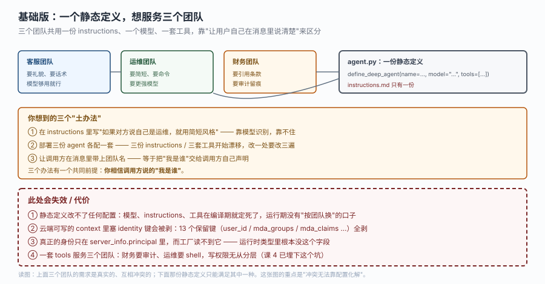
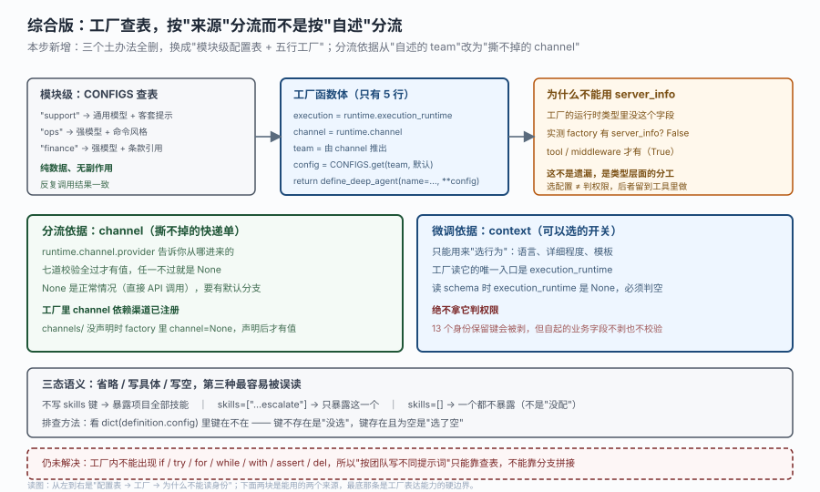

# 应用实战 · 运行时上下文

> 对应课程：[第 7 课：运行时上下文](../stages/3-运行与交付/lessons/07-运行时上下文.md) ｜ 覆盖知识点：三源分离、工厂的幂等约束、按运行选配置与清除语义
> 定位：**会用，不上生产**——课里学完，在这里动手（结构与边界见 SKILL.md「教学叙事骨架 · 应用实战」）。
> 📖 结论已按官方文档核对（核对于 2026-10 ｜ 来源：`/langsmith/python/managed-deep-agents-runtime`、`-agent-definition`、`-identity`）＋ 本机实测（`managed_deepagents 0.9.5`，`ManagedServerRuntime` 两种形态的字段、三态 config 键）

## 场景：一个部署，三个团队，三套口径

客服 agent 做得不错，运维和财务也想要。但你很快发现三个团队要的不是同一个东西：

| 团队 | 要什么 | 冲突点 |
|---|---|---|
| 客服 | 礼貌、有话术、模型够用就行 | 要便宜的模型 |
| 运维 | 简短、直接给命令、不要客套 | 要强模型 |
| 财务 | 回答必须引用条款编号，且要审计留痕 | 要强模型 + 更严的口径 |

三份需求互相冲突，但你不想维护三个部署：三份 `instructions.md` 会开始漂移，改一处要改三遍，而且云端三个 graph 的评估、监控、日志全要各做一遍。

**全貌一句话**：这一篇只解决"同一份代码怎么按来源给出不同配置"；配置里的权限判断不在这里做（那必须是工具里读 `principal`），审计留痕的系统也不在本课范围。

## ① 基础实现（能跑但幼稚）

第一反应是写个工厂函数，从 `context` 里读出团队名，返回不同的定义。你在请求里带上 `{"team": "ops"}`，跑通了。



> 看图：上面三个框是三个团队真实的需求，右下那个框是你能写的东西——一份静态定义、一份 `instructions.md`。中间黄框是你想到的三个土办法，它们是递进关系：前两个是"用一份东西凑合"，第三个是"让调用方自己报身份"。底部红框四条是这一版的失效点，其中第 ③ 条最关键：**你以为能拿到身份，但工厂的运行时类型里根本没有 `server_info` 这个字段**。

```python
# agent.py —— 想按团队分流，但分流的依据是"调用方自己说的"
from managed_deepagents import ManagedServerRuntime, define_deep_agent


def agent(runtime: ManagedServerRuntime):
    execution = runtime.execution_runtime
    context = execution.context if execution is not None else None

    team = (context or {}).get("team", "support")     # ← 调用方自己填的
    if team == "ops":                                  # ← 这行让 build 直接失败
        return define_deep_agent(name="assistant", model="openai:gpt-5.5")
    if team == "finance":
        return define_deep_agent(name="assistant", model="openai:gpt-5.5")
    return define_deep_agent(name="assistant", model="openai:gpt-5.5-mini")
```

`mda build` 立刻拦下：

```text
error: agent.py: agent name ... must be a static string literal
```

`name="assistant"` 明明是字面量，报错却说它不是。这不是误报，是静态扫描的真实规则：**工厂函数体里不能出现 `if` / `try` / `for` / `while` / `with` / `assert` / `del`**，嵌套函数体也算。构建器要在不执行工厂的前提下读出 graph ID，一旦函数体有分支它就无法静态确定返回值。

把 `if` 改成条件表达式与查表能绕过扫描，但另外两个问题绕不过：

> ⚠️ **它的问题**（四条）：
> 1. **分流依据不可信**。`context` 是调用方自己填的登记本，任何人写 `{"team": "finance"}` 就进了财务口径。更糟的是它看起来"能用"，所以没人会去质疑。
> 2. **工厂读不到真正的身份**。`runtime.server_info` 在工厂的运行时类型里根本不存在（实测 `hasattr` 为 False）。这不是版本遗漏，是把"选配置"和"判权限"从类型层面就分开。
> 3. **工厂会被调用四次以上，且没有缓存**。一次运行开始一次、恢复一次、重试一次，Agent Server 读 schema 还要一次。任何写在里面的副作用都会按次数重复。
> 4. **静态定义做不到这件事**。如果你不用工厂而直接 `agent = define_deep_agent(...)`，那 `instructions` / `skills` / `mcp` / `sandbox` 四个字段只能由项目文件决定——静态定义里没有"这一次"这个概念。

第 1 条和第 2 条合起来是一个结论：**工厂能选行为，但选不了权限**。想让"财务口径"只给财务用，靠工厂不行，得靠工具里的 `principal` 判断。

## ② 综合实现（被问题逼出来的下一步）

问题不是"if 写错了地方"，而是"把身份当成了配置"。改成托管口径：**配置表提到模块级，工厂只做查表与返回；分流依据用 `channel`（可信），行为微调用 `context`（可选），权限判断留在工具里。**



> 看图：最左是提到模块级的 `CONFIGS` 表（纯数据、无副作用），中间是工厂函数体——只有五行赋值与一个 `return`，没有任何分支语句。右边橙框回答最常见的疑问："为什么不能用 `server_info`"——实测工厂里 `hasattr(server_info)` 是 False，而 tool / middleware 是 True。中间两块绿蓝框是能用的两个来源：`channel` 判断"从哪来"、`context` 选"这次怎么说"。最下面灰框是三态语义，底部红字是工厂表达能力的硬边界。

**第一步：把配置表提到模块级。** 这一步同时解决两个问题——过静态扫描，以及满足"同一个输入永远同一句话"。

```python
# agent.py
from managed_deepagents import (
    ManagedServerRuntime,
    define_deep_agent,
)


# ---------- 模块级：纯数据，反复读取结果一致 ----------
CONFIGS: dict[str, dict[str, object]] = {
    "support": {
        "model": "openai:gpt-5.5-mini",
        "instructions": (
            "你是客服助手。语气礼貌，先共情再给方案，"
            "不承诺具体时效。用中文回答。"
        ),
    },
    "ops": {
        "model": "openai:gpt-5.5",
        "instructions": (
            "你是运维助手。直接给命令和判断依据，不要客套，"
            "不要重复用户已说的话。用中文回答。"
        ),
    },
    "finance": {
        "model": "openai:gpt-5.5",
        "instructions": (
            "你是财务助手。每条结论后必须标注依据的条款编号，"
            "形如（依据：FIN-3.2）。查不到条款就说不确定，不要推测。"
        ),
    },
}
DEFAULT_CONFIG = CONFIGS["support"]

# 渠道名 → 团队。渠道名来自 channels/ 里的声明，是部署侧的事实
CHANNEL_TEAM = {
    "ops-slack": "ops",
    "finance-slack": "finance",
}


# ---------- 工厂：只有赋值与 return ----------
def agent(runtime: ManagedServerRuntime):
    channel = runtime.channel
    team = CHANNEL_TEAM.get(channel.name) if channel is not None else None
    config = CONFIGS.get(team or "", DEFAULT_CONFIG)
    return define_deep_agent(name="assistant", **config)
```

这五行里没有 `if`、没有 `try`、没有循环。`channel is not None` 是条件表达式的一部分，不是独立语句——但为了保险，用 `.get()` 与 `or` 已经足够，写法越"表达式化"越安全。

**第二步：先把渠道声明出来，否则工厂里 `channel` 恒为 None。**

```python
# channels/ops_slack.py —— 声明即注册，工厂解析前就完成
from managed_deepagents import channels

channel = channels.slack(name="ops-slack")
```

```python
# channels/finance_slack.py
from managed_deepagents import channels

channel = channels.slack(name="finance-slack")
```

这一步不是可选的。实测结论是：**工厂能看到的 `channel` 依赖渠道已注册**——`channels/` 没声明时工厂里 `channel=None`，声明后才有值。因为 `register_channel_messaging(channels or [])` 在工厂解析之前就执行了。

工厂里用的 `channel.name` 就是这里的 `name="ops-slack"`，不是 Slack 里的显示名，也不是文件名。区分它和 `channel.provider` 很重要：`provider` 都是 `"slack"`，靠它分不出团队；`name` 才是每个声明独立的那个。

**第三步：`context` 只用来做行为微调，并且必须判空。**

```python
# agent.py 续 —— 用 context 调"这次说多细"，但不改身份
from dataclasses import dataclass


@dataclass
class AppContext:
    verbose: bool = False


def agent(runtime: ManagedServerRuntime):
    channel = runtime.channel
    team = CHANNEL_TEAM.get(channel.name) if channel is not None else None

    execution = runtime.execution_runtime
    context = execution.context if execution is not None else None
    verbose = bool((context or {}).get("verbose", False))

    config = dict(CONFIGS.get(team or "", DEFAULT_CONFIG))
    config["context_schema"] = AppContext        # 声明形状，LangGraph 按它校验
    if verbose:                                    # ← 不能这么写！
        config["instructions"] = config["instructions"] + "\n回答时补充判断依据。"
    return define_deep_agent(name="assistant", **config)
```

上面那段 `if verbose` 是**故意写错的示范**——它会让 `mda build` 报 `must be a static string literal`。工厂里不能有分支语句，所以"按开关改提示词"这件事只能靠查表：

```python
# 正确做法：把两种口径都放进表里
CONFIGS["support-verbose"] = {
    **CONFIGS["support"],
    "instructions": CONFIGS["support"]["instructions"] + "\n回答时补充判断依据。",
}

def agent(runtime: ManagedServerRuntime):
    channel = runtime.channel
    execution = runtime.execution_runtime
    context = execution.context if execution is not None else None

    team = CHANNEL_TEAM.get(channel.name) if channel is not None else None
    verbose = bool((context or {}).get("verbose", False))
    key = f"{team or 'support'}{'-verbose' if verbose else ''}"
    return define_deep_agent(name="assistant", **CONFIGS.get(key, DEFAULT_CONFIG))
```

`f"{...}{... if ... else ''}"` 是表达式，不是语句，能过扫描。代价是配置表要预先穷举组合——这是这套约束换来的确定性。

**第四步：搞清"清空"和"省略"，否则会误关能力。**

```python
# 三种写法，效果完全不同
define_deep_agent(name="a")                          # 省略 skills：暴露项目全部技能
define_deep_agent(name="a", skills=["./skills/escalate"])   # 选中：只暴露这一个
define_deep_agent(name="a", skills=[])               # 清空：一个都不暴露
```

实测 `dict(definition.config)` 的结果（这一条在排查时特别好用）：

```text
全省略          -> keys=['name']
skills=[]       -> keys=['name', 'skills'], 值 = ()      ← 注意是空元组，不是 []
mcp=None        -> keys=['mcp', 'name'],    值 = None    ← 键存在
instructions='' -> keys=['instructions', 'name']          ← 项目里那份整个不再读
```

规律：**省略 = 键不存在；清空 = 键存在且值为空**。反过来说，`instructions=""` 不是"少说两句"，而是项目里的 `instructions.md` 整个不再读——这是最容易被当成无害写法的一条。

另外两条实测出来的细节：`skills=["..."]` 里的路径必须**以 `skills/<名字>` 结尾**，写 `./other/escalate` 会直接 `TypeError: skills contains an invalid path`（`./skills/escalate`、`skills/escalate`、带尾斜杠三种都合法）；`skills=[]` 存进 config 后取出是 `()` 而不是 `[]`，运行期等价但你在日志里断言 `== []` 会得到 False。

**第五步：权限判断放到工具里，不要试图在工厂里做。**

```python
# tools/finance.py —— 真正的分权在这里
from langchain.tools import tool
from managed_deepagents import ManagedToolRuntime


@tool(parse_docstring=True)
async def read_ledger_entry(entry_id: str, runtime: ManagedToolRuntime) -> str:
    """读取一条财务分录。

    Args:
        entry_id: 分录编号，形如 L-2026-10-0001。
    """
    principal = runtime.server_info.principal if runtime.server_info else None
    if principal is None:
        return "需要登录后才能查看财务分录。"

    groups = principal.claims.get("groups") or ()
    if "finance" not in groups:
        return "你没有财务组权限。"

    return f"分录 {entry_id}：金额 12,400.00，状态已复核。"
```

工厂能决定"这次用哪套提示词和模型"，工具才能决定"这个人能不能看这条数据"。两件事分在两个地方，是因为它们依赖的证据不同：前者只需要"从哪来"，后者需要"他是谁"。

**验证清单（五条，逐条可查）：**

```text
① mda build                    -> exit=0，且没有 static string literal 报错
② dict(definition.config)      -> name / model / instructions / context_schema，没有多余键
③ 同一 context 连调工厂 3 次    -> 配置完全一致（无副作用、无缓存但结果稳定）
④ channels/ 未声明时           -> runtime.channel 为 None，走 DEFAULT_CONFIG
⑤ 非财务组调 read_ledger_entry -> 返回"你没有财务组权限"，而不是报错
```

第 ③ 条值得单独试一次：在工厂里加一行 `print(team)` 然后连调三次，你会看到三行进打印。这就是"没有缓存"的直观证据。

> 🎯 **会用标志**：能不看文档说清五件事——① 为什么工厂里不能写 `if`，报错文本又在说什么；② 工厂能拿到哪三个字段、拿不到哪一个；③ 什么时候该用 `channel` 分流、什么时候该用 `context` 微调；④ `skills=[]` 和"不写 skills"的差别；⑤ 为什么"这个团队只能用财务口径"这件事不该在工厂里判断。

## 🧭 导航

- ⬅️ 回到课程：[第 7 课：运行时上下文](../stages/3-运行与交付/lessons/07-运行时上下文.md)
- 📚 全部实战：[应用实战索引](INDEX.md)
- ⬅️ 上一篇实战：[06 · 团队记忆与个人记忆](06-记忆沙箱与身份.md)
- ➡️ 源码层展开：[源码解析 07 · compile_managed_agent_async 注入了什么](../源码解析/07-运行时上下文.md)
