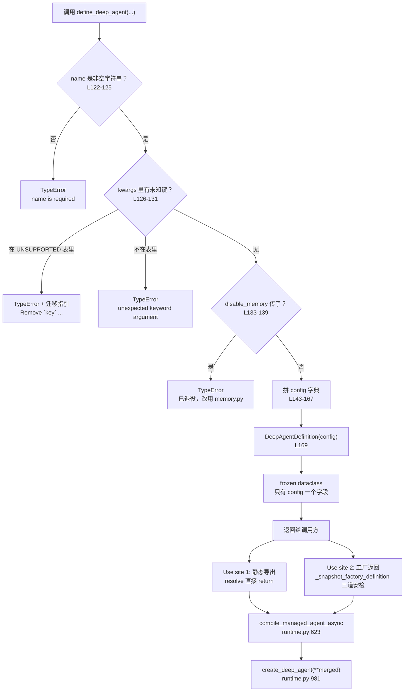
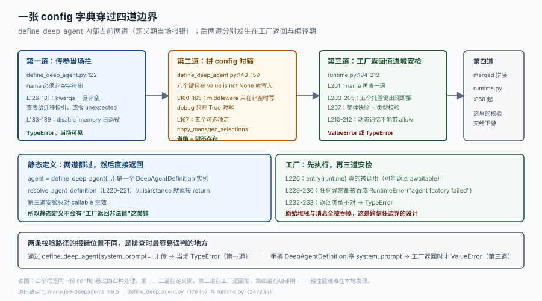

# 源码解析 · 托管的是什么

> 对应课程：[第 2 课：托管的是什么](../stages/1-定位与起跑/lessons/02-托管的是什么.md) ｜ 覆盖知识点：定义与编译分离、项目即配置、与 Deep Agents 的边界
> 源码锚点 @ `managed-deepagents 0.9.5`（2026-10-23）｜ 主文件 `managed_deepagents/define_deep_agent.py`（178 行）与 `runtime.py`（2472 行）
> 🔬 这一篇只读 Python 侧：TS 包被 bundle 成哈希文件名，逐行对照没有意义。

## 为什么读它

课 2 给了一句判断："`define_deep_agent` 返回的不是 agent，是一张图纸。"这句话很好记，但它的**证据在哪**决定了你以后能不能自己验证类似问题。

具体来说，这一篇要回答三个"凭什么"：

- 凭什么说 `DeepAgentDefinition` 是"数据"而不是"可运行对象"？——看它的字段数量与类型。
- 凭什么说 `define_deep_agent` 只做"筛键"，不做事？——看那 178 行里有没有任何一行碰过模型、网络或文件。
- 凭什么说"平台注入的东西你搜不到"？——看 `config` 里的键，和 `create_deep_agent` 真正收到的 kwargs，是两个不同的东西。

读完你会有个可复用的验证手法：**遇到"这个对象到底是什么"，别看文档，看它的 `__dataclass_fields__` 与构造函数的返回值。**

## 功能全貌

`define_deep_agent` 的全部工作可以拆成四步，而且没有第五步：



> 读图：上面那条竖链是 `define_deep_agent` 的全部——**它到 `return` 就结束了，没有编译、没有连接模型、没有读文件**。下面两个分叉是同一个定义对象的两种使用方式：静态导出被原样接受，工厂返回要先过一遍安检。两者最终都汇到同一个编译入口。

`config` 层的结构，另一张图讲得更细：



> 看图：四个横向框是同一份 config 经过的四道处理。注意第一道和第二道都在 `define_deep_agent` 内部（定义期，当场报错），第三道在工厂返回时（运行期，报错信息与第一道不同），第四道在编译期。**越往后越难在本地发现**——这就是为什么"同一个错误、两种报错"最容易误判。

## 源码直击

### 第一现场：它是个 dataclass，不是 runnable（L50-64）

```python
@dataclass(frozen=True)
class DeepAgentDefinition:
    """The pre-runtime spec returned by :func:`define_deep_agent`.

    It is intentionally *not* a compiled graph: the CLI generates an entry
    module that hands this definition to the managed runtime, which injects the
    managed backend/store/checkpointer and compiles it into a Deep Agent.
    """

    config: dict[str, object]
    kind: ClassVar[str] = "deep-agent"

    def __repr__(self) -> str:  # pragma: no cover - debug helper
        keys = ", ".join(sorted(self.config))
        return f"DeepAgentDefinition({keys})"
```

三行信息，把课 2 的结论钉死了：

- `config: dict[str, object]` 是唯一实例字段（`kind` 是 `ClassVar`，不占实例字段）。所以 `agent.config` 是你能读到的全部内容——没有 `invoke`、没有 `stream`、没有 `graph`。
- `frozen=True` 只保护**字段引用不被替换**（`agent.config = {...}` 抛 `FrozenInstanceError`），**不保护字典内容**：实测 `agent.config["model"] = "changed"` 会成功，且真的改了。所以"frozen 就是不可变"这个直觉在这里不成立——它是一个浅冻结。
- docstring 里那句 "It is **intentionally** *not* a compiled graph" 是官方自己写的设计声明——不是能力缺失，是刻意分层。

那条"frozen 不拦 dict 内容"值得单独记：它意味着你可以就地改 config，但**改了没有任何机制通知下游**——编译时按当时的内容读，所以这种改动在你调 `compile_managed_agent_async` 之前生效、之后无效。要做变体，正规做法是重新 `define_deep_agent(...)` 一次。

那句 `__repr__` 也很有用：它打印键名而不打印值。所以 `print(agent)` 会给你 `DeepAgentDefinition(model, name)` ——比 `object at 0x7f...` 有用得多，也比打印完整 config 更安全（不会把 prompt 打出来）。

### 第二现场：18 个显式参数里，有 8 个是"托管专有"（L78-99）

```python
def define_deep_agent(
    *,
    name: str,
    model: DeepAgentModel | None = None,
    tools: Sequence[DeepAgentTool] | None = None,
    middleware: Sequence[DeepAgentMiddleware] = (),
    subagents: Sequence[DeepAgentSubAgent] | None = None,
    permissions: Sequence[FilesystemPermission] | None = None,
    interrupt_on: Mapping[str, DeepAgentInterruptOn] | None = None,
    response_format: DeepAgentResponseFormat | None = None,
    context_schema: type[Any] | None = None,
    debug: bool = False,
    cache: BaseCache | None = None,
    instructions: str | Omitted | None = OMITTED,
    mcp: McpSelection | Omitted | None = OMITTED,
    sandbox: SandboxDefinition | Omitted | None = OMITTED,
    skills: SkillSelection | Omitted | None = OMITTED,
    memory: MemoryDefinition | Omitted | None = OMITTED,
    disable_memory: bool | None = None,
    metadata: Mapping[str, object] | None = None,
    **kwargs: Never,
) -> DeepAgentDefinition:
```

注意最后那个 `**kwargs: Never`。这是类型层面的封口：**运行时它是个普通 `**kwargs`（会接收任何键），但类型检查器看到 `Never` 就知道"这里不许传任何东西"**。所以 IDE 不会给你补全、mypy 会报错——但真正的拦截在函数体里。

两个细节值得单说：

`Omitted` 类型与 `OMITTED` 哨兵出现在五个参数上（`instructions` / `mcp` / `sandbox` / `skills` / `memory`）。默认值不是 `None`，是一个专门的哨兵对象。差异在 `_managed_composition.py:209-231`：

```python
def copy_managed_selections(
    instructions: str | Omitted | None,
    mcp: McpSelection | Omitted | None,
    sandbox: SandboxDefinition | Omitted | None,
    skills: SkillSelection | Omitted | None,
    memory: MemoryDefinition | Omitted | None,
) -> dict[str, object]:
    selected: dict[str, object] = {}
    if not isinstance(instructions, Omitted):
        if instructions is not None and not isinstance(instructions, str):
            raise TypeError("instructions must be a string or None")
        selected["instructions"] = instructions
    if not isinstance(mcp, Omitted):
        selected["mcp"] = None if mcp is None else snapshot_mcp_selection(mcp)
    # ... sandbox / skills / memory 同构
    return selected
```

这段是"三态语义"的出生地：`isinstance(x, Omitted)` 为真 → 不写键；否则写键，值可能是 `None` 或实际对象。**省略和写空在源头就分开了**，后面整条链都靠"键在不在"来区分。

`disable_memory` 是个"退役参数"，但保留在签名里（L96），因为要给出专门的迁移错误（L133-139）：

```python
    if disable_memory is not None:
        raise TypeError(
            "disable_memory is no longer supported in define_deep_agent(...). "
            "Durable memory is opt-in and declared in memory.py: export `memory` "
            "with `define_memory(agent=MemoryLayer())` to enable it, or leave the file "
            "out to keep no memory (the default). Remove `disable_memory` here."
        )
```

如果把它直接删掉，报错会变成通用的 `unexpected keyword argument 'disable_memory'` ——那句话不会告诉你"该怎么改"。保留一个参数的唯一目的就是给三行明确的迁移指引。**这是可以学的手法**：删 API 前先留一个会报错的占位。

### 第三现场：拼 config 的两段，用两种条件（L143-167）

```python
    config: dict[str, object] = {
        "name": name,
        **{
            key: value
            for key, value in (
                ("model", model),
                ("tools", tools),
                ("subagents", subagents),
                ("permissions", permissions),
                ("interrupt_on", interrupt_on),
                ("response_format", response_format),
                ("context_schema", context_schema),
                ("cache", cache),
            )
            if value is not None
        },
    }
    if middleware:
        config["middleware"] = middleware
    if debug:
        config["debug"] = debug
    if metadata is not None:
        config["metadata"] = dict(metadata)

    config.update(copy_managed_selections(instructions, mcp, sandbox, skills, memory))

    return DeepAgentDefinition(config)
```

三种条件写法，各自有理由：

- 八个键用 `if value is not None` ——因为它们的"没有"就是 `None`，没有三态需求。
- `middleware` 用 `if middleware:` ——因为它的默认值是空元组 `()`，用 `is not None` 会把空元组也写进去。这是个微妙差别：`middleware=()` 与 `middleware=None`（不可能）在这里等价，都不写键。
- `debug` 用 `if debug:` ——只有 `True` 才写。所以传 `debug=False` 与不传**完全等价**，`config` 里都不会有 `debug` 键。
- 五个可选项走 `update()` ——因为它们需要 `copy_managed_selections` 的三态判断，不能简单用 `is not None`。

`metadata` 那行有个 `dict(metadata)`：拷贝一份。因为 `metadata` 是 `Mapping` 不是 `dict`，原样存进 frozen dataclass 仍可能被外部修改——frozen 只保护字段引用不被替换，不保护引用指向的对象。这是一个容易忽略的可变性漏洞。

### 第四现场：`_snapshot_factory_definition` 的三道安检（L194-213）

工厂返回的定义要走另一条路：

```python
def _snapshot_factory_definition(selected: DeepAgentDefinition) -> DeepAgentDefinition:
    """Validate and copy a definition returned across the callback boundary."""
    try:
        config = dict(selected.config)
    except Exception:  # noqa: BLE001 - returned config is an untrusted callback value
        raise TypeError("agent factory returned an invalid definition") from None
    name = config.get("name")
    if not isinstance(name, str) or not name.strip():
        raise TypeError("agent definition must have a non-empty name")
    forbidden = {"backend", "store", "checkpointer", "system_prompt", "disable_memory"}
    if forbidden.intersection(config):
        raise ValueError("agent factory returned a managed runtime field")
    try:
        snapshot = snapshot_managed_composition(config)
    except Exception:  # noqa: BLE001 - returned config is an untrusted callback value
        raise TypeError("agent factory returned an invalid definition") from None
    selected_memory = snapshot.get("memory")
    if selected_memory is not None:
        assert_dynamic_memory_selection(cast("MemoryDefinition", selected_memory))
    return DeepAgentDefinition(snapshot)
```

关键在 `forbidden` 那个集合，与 `define_deep_agent` 里的 `DEFINE_DEEP_AGENT_UNSUPPORTED_KEYS` **不是同一个**：

| 键 | `define_deep_agent`（L67-75） | 工厂返回（L203） |
|---|---|---|
| `backend` | 拒，指引 `Configure the sandbox in sandbox/` | 拒 |
| `store` | 拒，`MDA provides the store automatically` | 拒 |
| `checkpointer` | 拒，同上 | 拒 |
| `system_prompt` | 拒，指引 `Use instructions ...` | 拒 |
| `state_schema` | 拒，`Custom state schemas are not supported in Python` | **不在集合里** |
| `disable_memory` | 独立分支，专门的长错误 | 在集合里 |

差异的原因很清楚：`define_deep_agent` 是给"人类手写代码"用的，所以每个键配一句"该改到哪里"；工厂返回值是"跨边界的不可信数据"，只做类型与键名检查，不需要迁移指引（写工厂的人已经会写代码了）。

而 `state_schema` 只在定义期被拒、在工厂检查里缺席，是因为它在定义期就被拦掉了，走不到工厂返回那一步——除非有人手搓 `DeepAgentDefinition({"name": "x", "state_schema": ...})`。**这就留了一个缝隙**：手搓可以塞进去。不过下游 `create_deep_agent` 也不认这个键，最终仍会报错，只是报错位置更晚。

### 第五现场：两种 entry 的合流点（L216-234）

```python
async def resolve_agent_definition(
    entry: AgentEntry, runtime: ManagedServerRuntime
) -> DeepAgentDefinition:
    """Resolve one managed definition without exposing callback data in errors."""
    if isinstance(entry, DeepAgentDefinition):
        return entry
    if not callable(entry):
        raise TypeError("agent export must be a managed agent definition or factory entrypoint")

    try:
        selected = entry(runtime)
        if inspect.isawaitable(selected):
            selected = await selected
    except Exception:  # noqa: BLE001 - callback failures cross an untrusted boundary
        raise RuntimeError("agent factory failed") from None
    # ...
```

`AgentEntry = DeepAgentDefinition | AgentFactory`（`agent_entry.py`）—— 一个联合类型，两个分支。静态定义走第一分支（直接 return，**不做安检**），工厂走第二分支（执行 + 安检）。

这里有个反直觉的点：静态定义**不过** `_snapshot_factory_definition`。所以理论上你在静态定义里塞进非法键，它不会被这道检查拦下。但静态定义是模块级导入时构造的，走的是 `define_deep_agent` 的三道校验，所以正常路径下不会出现非法配置。

## 设计权衡

**为什么用 dataclass 而不是 pydantic model？** pydantic 会做字段校验与类型转换，但 `config` 是 `dict[str, object]`——校验发生在**写入字典时**（`define_deep_agent` 函数体），不在构造 `DeepAgentDefinition` 时。用 dataclass 让"定义对象本身是哑的"，所有智能都在工厂函数里。好处是控制流清晰（读一个文件就能看懂校验）；代价是如果有人绕过工厂直接 `DeepAgentDefinition({...})`，就没有校验。

**为什么 `system_prompt` 被拒而不是被静默映射到 `instructions`？** 因为两个概念不等价：`system_prompt` 是"整段提示词"，而 `instructions` 是"会被平台拼上固定前言的那段"。静默映射会让用户以为自己掌控了完整 prompt，实际上平台前言永远在前面。拒绝比猜测更安全。

**为什么 `metadata` 要单独处理？** 它不是 `create_deep_agent` 的 kwarg，是 LangSmith 的运行时配置。所以它在 `define_deep_agent` 里进 config，在 `compile_managed_agent_async` 里被 pop 出来，最后通过 `compiled.with_config({"metadata": ...})` 挂到 runnable 上。**一个键穿过三个文件**，只为了让它落在正确的层级。

**为什么 `name` 要查两次？** `define_deep_agent` 查一次（L122），工厂返回再查一次（L201）。因为工厂可以返回手搓的 `DeepAgentDefinition`，绕过构造校验。这是"信任边界"的标准做法：进入不可信区域前查一次，出来再查一次。

## 回扣用法

| 课里的说法 | 源码里的位置 | 你能用它做什么 |
|---|---|---|
| `DeepAgentDefinition` 没有 `invoke` | L50-64，只有一个 `config` 字段 | 想在本地跑，必须 `mda dev` 或自己调 `create_deep_agent` |
| 传 `system_prompt` 会报错并给指引 | L67-75 + L126-131 | 报错文本就是迁移指令，直接照它改 |
| 传 `backend` / `store` / `checkpointer` 被拒 | 同上 | 这三个都是平台注入的，你改不了也不需要改 |
| 省略 vs 清空的区别 | `copy_managed_selections`（`_managed_composition.py:209`） | 用 `"skills" in agent.config` 判断这次是"没选"还是"选了空" |
| 静态定义与工厂是两种 entry | `agent_entry.py` 的 `AgentEntry` 联合类型 | 想按运行选配置就必须用工厂；静态定义没有"这一次" |
| 工厂异常被吞成一句话 | L229-230 | 排查工厂问题不能靠读异常消息，要在函数体里自己打日志 |

## 🔬 看透标志

不看源码回答这四个问题：

1. `define_deep_agent` 那 178 行里，有没有任何一行读文件、连网络、或构造模型客户端？
2. `agent.config` 里为什么可能没有 `"skills"` 这个键，也可能有但值是空元组？
3. 同样传 `system_prompt`，为什么"通过 `define_deep_agent` 传"和"手搓定义塞进 config"报的错不一样？
4. 静态定义和工厂返回，哪个会过 `_snapshot_factory_definition`？为什么这么设计？

答案分别在：第 1 题的整段（没有，全部是校验与字典拼装）、第 2 题的 `copy_managed_selections`（`Omitted` 不写键，`None`/空元组写键）、第 3 题的 L67-75 与 L203-205（两套不同的校验集合，报错位置与类型都不同）、第 4 题的 L220-221（静态定义直接 return，因为它在模块导入时就过了构造校验）。

## 🧭 导航

- ⬅️ 回到课程：[第 2 课：托管的是什么](../stages/1-定位与起跑/lessons/02-托管的是什么.md)
- 🎯 配套实战：[应用实战 02 · 同一份逻辑，托管前后差在哪](../应用实战/02-托管的是什么.md)
- 📚 全部解析：[源码解析索引](INDEX.md)
- ➡️ 另一篇解析：[07 · compile_managed_agent_async 注入了什么](07-运行时上下文.md)
