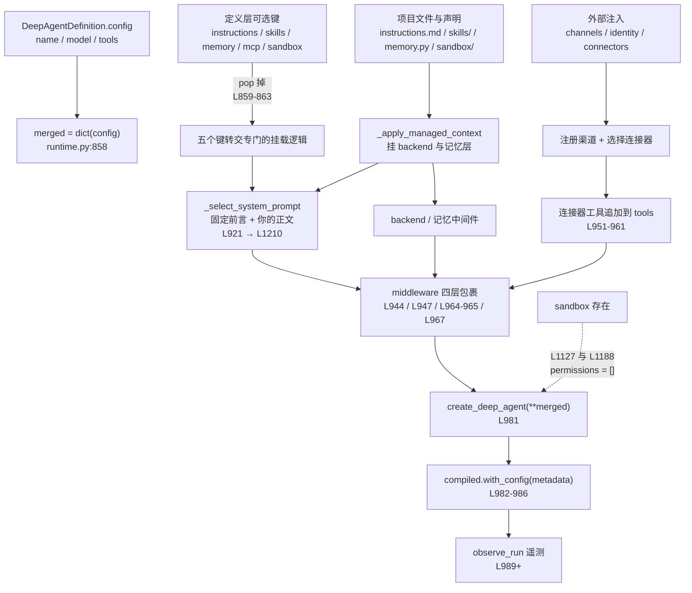
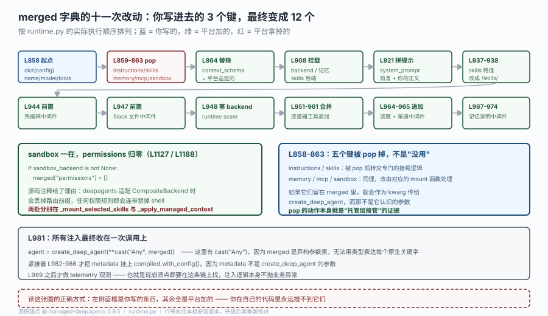

# 源码解析 · 运行时上下文

> 对应课程：[第 7 课：运行时上下文](../stages/3-运行与交付/lessons/07-运行时上下文.md) ｜ 覆盖知识点：三源分离、工厂的幂等约束、按运行选配置与清除语义
> 源码锚点 @ `managed-deepagents 0.9.5`（2026-10-23）｜ 主文件 `managed_deepagents/runtime.py`（2472 行）
> 🔬 这一篇只读 Python 侧：TS 包被 bundle 成哈希文件名，逐行对照没有意义（与全库"源码解析仅 Python"的约定一致）。

## 为什么读它

课 7 讲的三件事——三源分离、工厂幂等、按运行清空——都是"从外面看"的结论。你会记住"工厂读不到 `server_info`"，但记不住它是**怎么被结构性挡掉的**；你会记住"`instructions=""` 会压掉项目文件"，但记不住压掉发生在**哪一行**。

这一篇要回答的是三个"为什么这样设计"：

- 为什么 `permissions` 一遇到 `sandbox` 就被清空，而且清空发生在两个不同的地方？
- 为什么 `define_deep_agent` 装了 18 个显式参数，实际传给 `create_deep_agent` 的却是十几个拼装出来的键？
- 为什么固定前言永远在你写的内容前面，且**没法**覆盖它？

读完你会有一个可复用的判据：**凡是你在自己代码里搜不到的运行时行为，都要去 `merged` 这个字典里找**。

## 功能全貌

`compile_managed_agent_async` 是"定义 → 可运行 agent"的唯一收口。它的工作可以概括成一句话：**把用户写的少量键，和平台按声明探测到的资源，拼成一份 `create_deep_agent` 能吃的 kwargs**。



> 读图：左边的三个来源（你写的定义、项目文件、平台注入）最后汇到同一条链上。中间那条橙色虚线是本篇第一个重点——`permissions` 的清空不在这条主链上，而是藏在 `_apply_managed_context` 与 `_mount_selected_skills` 两个下游函数里，所以在主流程里 grep 不到。

数据结构层的变化，另一张图讲得更细：



> 看图：蓝框是你写的三个键，红框是被拿掉的，绿框全是平台加的。重点看第二行那五个 `pop` —— 它们不是"清理无用字段"，而是"把这五个键从 kwargs 通道转交到挂载逻辑"，这是理解整个注入机制的关键一步。

## 源码直击

### 第一现场：五个键被 pop 出去（L858-864）

```python
    merged: dict[str, object] = dict(definition.config)
    authored_instructions = merged.pop("instructions", _OMITTED)
    authored_skills = merged.pop("skills", _OMITTED)
    merged.pop("memory", None)
    merged.pop("mcp", None)
    merged.pop("sandbox", None)
    merged["context_schema"] = context_schema
```

这段是整个文件里信息密度最高的六行。逐点读：

- `dict(definition.config)` 是**浅拷贝**。你写的 `tools` 列表仍然是同一个对象引用——所以后面 `merged["tools"] = authored_tools + connector_tools` 是新建列表，不会改到你的定义。
- `instructions` 与 `skills` 用 `_OMITTED` 哨兵作默认值，另外三个用 `None`。这个不对称是有意的：前两个需要区分"没传"和"传了空"（`""` 与 `[]` 是合法的清空指令），后三个 `None` 本身就是清空语义。
- 五个 `pop` 的后果是：**它们不会作为 kwarg 传给 `create_deep_agent`**。因为 `create_deep_agent` 不认识 `memory` / `mcp` / `sandbox` 这些托管概念——那是 MDA 的抽象，不是 Deep Agents 的。
- `merged["context_schema"] = context_schema` 是覆盖赋值，不是你传的值。平台把解析后的 schema 塞进来，所以你在工厂里写的 `context_schema` 走到这里已经被"选定"过了。

### 第二现场：系统提示的拼装（L921 → L1210-1233）

调用点只有一行，但真正的逻辑在 300 行之后：

```python
    merged["system_prompt"] = _select_system_prompt(
        authored_instructions,
        context.backend if context is not None else None,
        system_prompt,
    )
```

```python
def _select_system_prompt(
    authored: object,
    context_backend: BackendProtocol | None,
    fallback: str | None,
) -> str:
    """Choose authored instructions while preserving MDA's platform boundary."""
    if authored is not _OMITTED:
        if authored is None:
            selected = ""
        elif isinstance(authored, str):
            selected = authored
        else:
            raise TypeError("instructions must be a string or None")
    elif context_backend is not None:
        selected = _read_context_instructions(context_backend)
    else:
        selected = None
    if selected is None:
        selected = fallback
    return (
        f"{MANAGED_DEEP_AGENT_INSTRUCTIONS}\n\n{selected}"
        if selected
        else MANAGED_DEEP_AGENT_INSTRUCTIONS
    )
```

这段把课 7 的所有"三态"结论一次性解释了：

| 你写的 | `authored is _OMITTED` | 结果 |
|---|---|---|
| 不传 | True | 走 `context_backend` 读项目 `instructions.md`；读不到就用 `fallback` |
| `None` | False | `selected = ""`，**项目文件完全不读** |
| `""` | False | `selected = ""`，同上 |
| `"hi"` | False | `selected = "hi"`，项目文件不读 |
| `123` | False | `TypeError: instructions must be a string or None` |

注意 `None` 和 `""` 在这里**行为完全一致**：都变成空串，都不读项目文件（`L1217-1220` 两个分支都赋 `""`）。课里说"`instructions=None` 和 `''` 都清空"，根因就是这两行。

固定前言在文件常量区（`runtime.py:249-253`）：

```python
MANAGED_DEEP_AGENT_INSTRUCTIONS = (
    "<managed_deep_agent>\n"
    "You are a Managed Deep Agent (MDA), built on LangChain's Deep Agents harness.\n"
    "</managed_deep_agent>"
)
```

它是**硬编码常量**，没有配置项、没有环境变量、没有参数能改。而拼接方向是 `f"{常量}\n\n{你的内容}"` ——你的内容永远在后。这就是"你改不掉它"的实现层原因，不是"文档这么说的"。

还有一个容易忽略的分支：如果 `selected` 是空串（`""` 或 `None`），返回的是**只有前言**，而不是空字符串。所以"清空 instructions"的真实效果是"system prompt 只剩那句平台标识"，不是"没有 system prompt"。这两者在模型行为上差别不小。

### 第三现场：permissions 被清空的两处（L1127 与 L1188）

这是全篇最值得读的一段，因为它出现在两个不同函数里，而只有一处带注释。

两处行号分别是 `L1127`（在 `_mount_selected_skills`，函数起点 L1112）和 `L1188`（在 `_apply_managed_context`，函数起点 L1135）。看调用链就明白为什么要两处：主流程有两条分支，`context` 不为 None 时走 `_apply_managed_context`，`context` 为 None 且选了技能时走 `_mount_selected_skills`。**两条路都可能拿到 sandbox，所以两边都得清一次。**

这也解释了一个排查现象：如果只在 `_apply_managed_context` 里加日志，另一条分支的清空你看不到。

注释只写在其中一处（`L1184-1186`，在 `_apply_managed_context` 里）：

```python
    # Sandbox + FilesystemPermission cannot coexist at execute() time: deepagents
    # adapts CompositeBackend and drops route prefixes, so any permission rule
    # disables shell. Rely on read-only Context Hub mounts instead.
    if sandbox_backend is not None:
        merged["permissions"] = []
```

`_mount_selected_skills` 里那处（L1126-1128）没有任何注释，只多了一行 `return`：

```python
    if sandbox_backend is not None:
        merged["permissions"] = []
        return
```

那个 `return` 是两处代码的实质差别：`_mount_selected_skills` 清空后直接返回，不再调 `_managed_context_permissions`；而 `_apply_managed_context` 走的是 `if / else` 两支，清空时跳过、否则才计算权限。

注释里那句 "deepagents adapts CompositeBackend and drops route prefixes" 是根因：deepagents 在挂载复合 backend 时会丢失路由前缀，于是任何权限规则都会连带把 `execute` 工具关掉。平台的取舍是"保留 shell，丢掉规则"，而不是"保留规则，丢掉 shell"。官方文档给的替代路线也与此一致——**用你给它的工具来限制它**。

### 第四现场：middleware 的四层包裹（L944-974）

```python
    _prepend_credential_gate_middleware(merged, connectors, sandbox)
    _prepend_slack_files_middleware(merged, channels)
    _apply_runtime_seam(merged, backend_factory)
    # ...
    if connectors and not skip_factory_inspection_tools:
        tools_value = merged.get("tools")
        authored_tools = (
            list(cast("Iterable[object]", tools_value)) if tools_value is not None else []
        )
        connector_tools = load_connector_tools(connectors)
        if identity is not None:
            connector_tools = wrap_tools_with_managed_runtime(connector_tools)
        merged["tools"] = authored_tools + connector_tools

    # Managed prompt behavior surrounds authored middleware in the same order as TS.
    _prepend_schedule_delivery_middleware(merged)
    _append_channel_response_format_middleware(merged)
    if mounted_memory:
        _append_memory_instructions_middleware(...)
```

顺序值得记：`prepend` 两次、`append` 两次。这解释了课 5 那条"中间件是嵌套栈不是队列"——平台自己的中间件包在你的外面，且在栈的两端：凭据闸与 Slack 文件在最外层（`prepend`），调度投递与渠道格式在最内层（`append`）。

`_apply_runtime_seam` 是另一个关键函数（`L1354`）：

```python
def _apply_runtime_seam(merged: dict[str, object], backend_factory: RuntimeBackendFactory) -> None:
    """Wrap authored tools and middleware with managed runtime fields."""
    tools_value = merged.get("tools")
    if tools_value is not None:
        merged["tools"] = wrap_tools_with_managed_runtime(
            list(cast("Iterable[DeepAgentTool]", tools_value)), backend_factory
        )
```

这一步把你的工具"包"了一层，让它们能收到带 `server_info` / `channel` / `backend` 的运行时对象。**注意它只包装 `tools` / `middleware` / `subagents`，不包装工厂**——因为工厂在更早的地方就已经执行完了。这就是"工厂读不到 `server_info`"的结构性原因：不是忘了加，而是包装发生在工厂返回之后。

### 第五现场：收口与收尾（L978-986）

```python
    # Author ``metadata`` is not a create_deep_agent kwarg — apply it on the
    # compiled runnable so LangSmith root runs carry prompt provenance, etc.
    metadata = merged.pop("metadata", None)
    # The definition and managed adapters are validated at their own boundaries.
    # This heterogeneous argument map cannot express each native keyword type.
    agent = create_deep_agent(**cast("Any", merged))
    compiled = (
        agent.with_config({"metadata": dict(metadata)})
        if isinstance(metadata, Mapping) and metadata
        else agent
    )
```

`metadata` 被单独 pop 出来，因为它是 LangSmith 的运行时配置，不是图构造参数。`cast("Any", merged)` 这句注释很实在：`merged` 是异构字典，静态类型表达不了每个原生的关键字类型，所以这里放弃了类型检查——**这也是为什么参数拼错时你只会得到运行期错误，而不是类型错误**。

## 设计权衡

**为什么用"字典拼接"而不是"参数直传"？** 直传要写十几个 `if xxx is not None: kwargs["xxx"] = xxx`，而拼接可以在中途任意增删，代价是丢掉静态类型（`cast("Any")` 就是代价的凭证）。这套取舍在"参数来源多且互相覆盖"的场景下是合理的——你的定义、项目文件、外部注入三者的优先级只能靠顺序表达。

**为什么 pop 而不是新建字典？** 因为要保留你传的其他键（`response_format`、`interrupt_on`、`subagents` 等）原样透传。新建字典要逐个列举已知键，新增键时容易漏。pop 是"白名单式的搬运"——搬走我知道怎么处理的，剩下的原样给下游。

**为什么 permissions 清空要写两处而不是抽个函数？** 从代码看没有抽。这是可维护性的一个小缺陷：两处逻辑相同、注释只在其中一处。对读源码的人来说，容易以为只有一处。

**为什么固定前言是常量而不是可配置？** 它承担平台标识职责（让模型知道自己跑在托管环境里，从而遵守相应的行为约束）。可配置就意味着可被覆盖，可被覆盖就意味着平台边界消失。

## 回扣用法

对应课 7 的三个知识点，源码给出的可操作结论：

| 课里的说法 | 源码里的位置 | 你能用它做什么 |
|---|---|---|
| 工厂里没有 `server_info` | `_apply_runtime_seam`（L1354）在工厂之后执行 | 别在工厂里试 `hasattr(runtime, "server_info")`，它永远是 False |
| `instructions=None` 与 `""` 等效 | `_select_system_prompt` 的 `L1217-1220` 两个分支都赋 `""` | 想清空就写 `""`，不必纠结用哪个 |
| 清空后 system prompt 不是空的 | 返回的是 `MANAGED_DEEP_AGENT_INSTRUCTIONS`（L1229-1233） | 排查"为什么它还在自我介绍"时，别怀疑自己的代码 |
| `permissions` 被静默清空 | L1127 与 L1188 两处 `merged["permissions"] = []` | 想同时要 shell 和权限规则是不可能的，改走工具收窄 |
| `config` 里键在不在能看出三态 | `dict(definition.config)`（L858）就是你在探针里看到的东西 | 用 `"skills" in definition.config` 判断"选了"还是"没选" |
| middleware 是嵌套栈 | 两处 `prepend`、两处 `append`（L944-974） | 你的中间件永远在凭据闸里面、在调度投递外面 |

## 🔬 看透标志

能不看源码回答这四个问题，说明这一篇读到位了：

1. 你写 `define_deep_agent(name="x", sandbox=None, memory=None)`，最终 `create_deep_agent` 的 kwargs 里有 `sandbox` 和 `memory` 这两个键吗？为什么？
2. `instructions=""` 之后，模型的 system prompt 里还剩什么？
3. 为什么 `permissions` 的清空逻辑有两处，而主流程里 grep 不到？
4. 你在工厂里写 `hasattr(runtime, "server_info")`，得到什么？这个结果的成因在源码哪一行？

答案分别在：第 1 题的 `L859-863`（pop 掉，所以没有）、第 2 题的 `L1229-1233`（只剩平台固定前言）、第 3 题的 `L1127 / L1188`（两条挂载分支各清一次，都在下游函数里）、第 4 题的 `L1354`（`_apply_runtime_seam` 在工厂返回后才包装工具）。

## 🧭 导航

- ⬅️ 回到课程：[第 7 课：运行时上下文](../stages/3-运行与交付/lessons/07-运行时上下文.md)
- 🎯 配套实战：[应用实战 07 · 一个部署，三个团队](../应用实战/07-运行时上下文.md)
- 📚 全部解析：[源码解析索引](INDEX.md)
- ➡️ 另一篇解析：[02 · define 到 create 的编译链路](02-托管的是什么.md)
